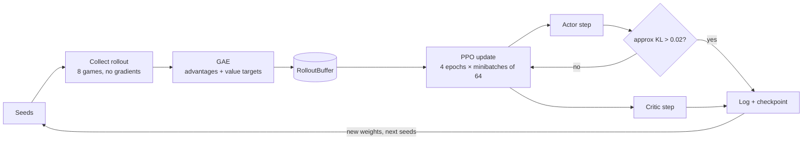

# Learning-to-Play-Hearthstone-Battlegrounds-Through-Self-Play-Reinforcement-Learning

## Desktop client

Play as a selected seat against random bots, or use spectator mode to watch an
all-bot match:

```powershell
python -m pip install pygame        # once; needed for the default table view
python -m hsbg.play --seed 7
python -m hsbg.play --spectate --seed 7
python -m hsbg.play --spectate --pov player-3   # follow one player only
python -m hsbg.play --ui tk                     # original text client
```

The default Pygame client draws a Battlegrounds-style table: Bob's Tavern,
your warband and hand as cards with attack/health gems, a lobby of heroes, and
an animated combat screen where attacks, damage numbers, Divine Shield pops,
deaths, and Deathrattle summons play out step by step. Click a shop card to
buy, a hand card to play, or a board minion to sell or move it; hover any card
for its text. "View as" (or clicking a hero in the lobby) shows only that
player's tavern, log, and combats. Space pauses, N steps, +/- change speed,
and Esc skips a combat.

The client uses the shared match engine and random bots. It labels the shop,
hand, and board with minion stats, explains the available actions, and records
plain-language recruit and combat events. It supports pausing, single-action
stepping, playback speed adjustment, and replaying the most recently completed
match. The current game-rule values remain configurable prototype assumptions
rather than confirmed historical patch rules.

To play against or watch a trained agent, pass a checkpoint (see
[Training (PPO)](#training-ppo)):

```powershell
python -m hsbg.play --agent checkpoints/run1/ppo_latest.pt                 # you vs agent (player-2)
python -m hsbg.play --spectate --agent checkpoints/run1/ppo_latest.pt --pov player-1
python -m hsbg.play --agent checkpoints/run1/ppo_latest.pt --agent-seats player-2,player-3
```

The agent samples its moves the way it did in training; `--agent-greedy`
makes it always take its top choice instead. Agent seats are labelled
"(agent)". Only the Pygame client supports agents.

### Basic controls

1. **Buy** minions from the shop; buying spends gold and puts the minion in hand.
2. **Play** minions from hand onto your board. The leftmost board minion attacks
   first.
3. **Sell** a board minion to get the configured gold refund. You can also
   reroll the shop, freeze offers for next turn, or upgrade your Tavern.
4. Press **End Recruit** when ready. Combat starts after all players are ready.
   The event feed explains attacks, shields, deaths, summons, and damage.

## RL environment

`hsbg/env.py` wraps the engine for one learning seat (needs `numpy`:
`pip install -e .[rl]`). The env itself has no training code; the PPO trainer
is described under [Training (PPO)](#training-ppo).

```python
from hsbg.env import BattlegroundsEnv

env = BattlegroundsEnv.from_profile("data/profiles/initial-15.6.json")
obs, info = env.reset(seed=0)            # obs: float32 vector, env.observation_size
mask = info["action_mask"]               # bool vector, env.action_size (112)
obs, reward, terminated, truncated, info = env.step(index)  # index where mask is True
```

- **Actions** are fixed indices (buy slot, play hand slot, optionally on a
  board target, sell, move left/right, reroll, freeze, upgrade, end turn).
  `env.describe_action(i)` names one.
- **Observation** is your own economy, shop, hand and board (per-card stats,
  tribes, keywords, card one-hot), the other seats' public health and tier,
  and your last combat result. `env.encoder.sections` gives each block's slice.
- **Step** applies your action; after "end turn" the other seats play and
  combat resolves before `step` returns. Reward is 0 until you finish, then
  +1 (1st) to -1 (8th).
- **Opponents** default to random bots. Pass `opponents={"player-2": policy}`
  with either an `ActionAgent` or an object with
  `choose_index(observation, mask, rng)` (e.g. a frozen copy of your policy
  for self-play). `env.engine` exposes the live match, including `to_replay()`.

### Actor network

`hsbg/actor.py` is the policy network (needs `torch`, also in `.[rl]`). It is a
simple feed-forward network that picks one of the 112 actions:

| Layer | Size | Activation |
|---|---|---|
| Input | 1,076 observation features | — |
| Hidden 1 | 256 neurons | LayerNorm, ReLU |
| Hidden 2 | 256 neurons | LayerNorm, ReLU |
| Output | 112 action scores | masked softmax |

Illegal actions are masked out, so the actor only ever picks legal moves.
`ActorConfig(hidden_sizes=...)` changes the number or size of hidden layers.

```python
from hsbg.actor import ActorNetwork
from hsbg.selfplay import ActorPolicy

actor = ActorNetwork.from_env(env)
action, log_prob, entropy = actor.act(obs_tensor, mask_tensor)   # choose an action
log_prob, entropy = actor.evaluate_actions(obs, mask, actions)   # PPO update
env.opponents["player-2"] = ActorPolicy(actor)                   # self-play opponent
```

### Critic network and on-policy rollout buffer

Run `python -m rl.critic_example` to collect two games with the actor and
train the critic on their value targets. The [critic and sample memory
specification](CRITIC_AND_SAMPLE_MEMORY.md) covers network dimensions,
buffer fields, advantage estimation and the interface for PPO updates.

## Training (PPO)

`rl/train_ppo.py` trains the actor and critic with PPO (needs `.[rl]`). One
iteration plays a batch of games with the current policy, scores every
decision, then updates both networks on that batch and throws it away.

```powershell
python rl/train_ppo.py --iterations 200 --checkpoint-dir checkpoints/run1
python rl/train_ppo.py --resume checkpoints/run1/ppo_latest.pt --iterations 200 --checkpoint-dir checkpoints/run1
```

On CPU an iteration of 8 games takes about 3–6 seconds.

### The training loop



1. **Seeds.** Each game gets its own seed (`--seed 7` gives games 7–14, then
   15–22, …). A seed fixes the shop rolls, combat randomness and random bots'
   choices, so runs are reproducible and no game is replayed.
2. **Collect** (`hsbg/rollout.py`, `collect_rollout`). With gradients off, the
   actor reads each observation, masks illegal actions, samples a move and
   stores its log-probability; the critic stores `V(s)`. Reward is 0 until
   the game ends, then the placement reward (+1 for 1st to −1 for 8th). The
   networks do not change during collection, so every decision comes from
   the same policy.
3. **Score with GAE.** After each game, it is walked backwards:
   `δ = r + γ·V(s′) − V(s)` and `Â = δ + γλ·Â_next`, with `V(s′) = 0` after the
   last step. `Â` (the advantage) says how much better than expected each
   action turned out. The critic's value target is `V(s) + Â`. Defaults:
   `γ = 1.0`, `λ = 0.95`.
4. **Buffer.** All games are stacked into one `RolloutBuffer` of N rows
   (observations, masks, actions, old log-probs, advantages, value targets).
   It stays fixed for the whole update.
5. **PPO update** (`hsbg/ppo.py`, `update_ppo`). Advantages are normalized
   over the buffer. For each of 4 epochs the rows are shuffled into
   minibatches of 64, and for each minibatch:
   - **Actor:** `ratio = exp(logπ_new − logπ_old)`, loss =
     `−min(ratio·Â, clip(ratio, 0.8, 1.2)·Â) − 0.01·entropy`. The clip stops one
     batch from moving the policy too far.
   - **Critic:** loss = `0.5·(V(s) − target)²`, with its own Adam optimizer.
   - Both gradients are clipped to norm 0.5.
   - **KL check:** if `mean |logπ_old − logπ_new| > 0.02`, the update stops early.
6. **Log and checkpoint**, then repeat with the new weights on new seeds.

### Reading the log

```
iteration=3 episodes=8 decisions=893 mean_episode_return=0.0357 policy_loss=… value_loss=… entropy=… approx_kl=…
```

| Field | Meaning |
|---|---|
| `decisions` | Rows in the buffer (all decisions in the 8 games). |
| `mean_episode_return` | Average placement reward: +1 always 1st, 0 mid-lobby, −1 always last. The main progress signal against random bots; noisy, so watch the trend. |
| `policy_loss` | Clipped actor loss. Hovers near 0 because advantages are normalized; not a progress measure. |
| `value_loss` | Critic error. Should drop early on. |
| `entropy` | How spread out the actor's choices are. Should fall slowly, not collapse to 0. |
| `approx_kl` | How far this update moved the policy. Should stay small but non-zero. |

The losses, entropy and KL are averages over the minibatches processed.

### Checkpoints

Every `--save-every` iterations (default 10) the trainer writes
`ppo_<iteration>.pt` and overwrites `ppo_latest.pt` in `--checkpoint-dir`. Each
holds both networks, both Adam optimizer states, the iteration, the next
seed and the PPO config, so `--resume` continues from the next iteration on
unseen seeds. Starting without `--resume` begins from random weights and
overwrites files with the same names in that folder, so give each run its own
directory.

Only each run's `ppo_latest.pt` is committed, through [Git LFS](https://git-lfs.com)
(intermediate `ppo_<iteration>.pt` files and logs stay local). Run
`git lfs install` once before cloning or pulling; without it the `.pt` files
arrive as small text pointers and fail to load (`git lfs pull` fixes that).
To share an updated model, re-run `git add checkpoints` and commit.

### Self-play

By default all 7 opponents are random bots. With `--self-play` they are frozen
snapshots of the learner:

```powershell
python rl/train_ppo.py --self-play --iterations 200 --checkpoint-dir checkpoints/selfplay1
python rl/train_ppo.py --self-play --pool-size 5 --random-opponents 1 --iterations 200 --checkpoint-dir checkpoints/selfplay2
```

After each update a copy of the actor joins a pool (`SnapshotPool` in
`hsbg/selfplay.py`), and before each iteration every opponent seat draws a
snapshot from it. `--pool-size 1` means every opponent is the previous
iteration's agent; a larger pool mixes in older versions, which helps the
agent keep beating strategies it has already seen. `--random-opponents N`
keeps N seats as random bots. The pool is not saved in checkpoints and
restarts from the loaded actor on `--resume`.

In self-play, `mean_episode_return` stays near 0 even when the agent improves,
because its opponents improve with it. Measure progress against fixed
opponents instead (below).

### Testing a checkpoint

```powershell
python rl/evaluate.py checkpoints/run1/ppo_latest.pt --episodes 200
```

This plays games against random bots on seeds 1000+, which training never
uses, and prints `mean_reward`, `mean_placement` (1 = always 1st, 8 = always
last; random play averages about 4.5) and `mean_decisions`. Evaluate several
checkpoints on the same seeds: if `mean_placement` stops improving between
them, training has levelled off. `evaluate.py` always takes the agent's top
choice, and early checkpoints can get stuck toggling freeze until the
per-turn action limit, which makes them look worse than they play when
sampling.

To watch or play against a checkpoint, see [Desktop client](#desktop-client).

### Main settings

| Setting | Default | Where |
|---|---|---|
| Iterations / episodes per rollout | 10 / 8 | `--iterations`, `--episodes-per-rollout` |
| Actor / critic learning rate | 3e-4 / 3e-4 | `--actor-lr`, `--critic-lr` |
| γ / λ | 1.0 / 0.95 | `--gamma`, `--gae-lambda` |
| Epochs / minibatch size | 4 / 64 | `PPOConfig` in `train_ppo.py` |
| Clip ε / entropy coef / value coef | 0.2 / 0.01 / 0.5 | `PPOConfig` |
| Max grad norm / target KL | 0.5 / 0.02 | `PPOConfig` |
| Checkpoint interval | 10 | `--save-every` |
| Self-play pool / random seats | off, 1 / 0 | `--self-play`, `--pool-size`, `--random-opponents` |

Games average roughly 100 decisions, so with `λ = 0.95` the final reward
reaches the first decisions only weakly until the critic has learned useful
values; `--gae-lambda 0.98` is worth comparing.

## Cards and profiles

All card data lives in one file, `data/cards.json`: 1,092 cards from every
patch sheet of the original `season -1 (beta).xlsx`, keyed by `sheet:row` IDs
such as `15.6:17`. Different patch versions of a card are simply different
cards. Each entry holds everything about the card:

```json
{ "id": "15.6:17", "name": "Nathrezim Overseer", "tier": 2,
  "tribe": "Demon", "type": "Demon", "attack": 2, "health": 4,
  "text": "Battlecry: Give a friendly Demon +2/+2.",
  "implemented": true,
  "effects": [{ "trigger": "battlecry", "operation": "buff",
                "target": "friendly_demon", "attack": 2, "health": 2 }] }
```

- `text` is shown to players only; behaviour comes from `effects`.
- `implemented: false` cards (no `effects` key) keep their stats and text for
  reference but cannot be put in a game. To implement one, describe it with the
  supported triggers (`passive`, `battlecry`, `deathrattle`) and operations
  (`keyword`, `summon`, `buff`, `damage_hero`), set `implemented` to `true`, and
  list its `effects` (`[]` for a vanilla minion).

A profile in `data/profiles/` chooses which cards are in the minion pool and
sets the game rules:

```json
{ "iteration_id": "initial-15.6", "cards_file": "../cards.json",
  "rules": { "player_count": 8, "...": "..." },
  "enabled_card_ids": ["15.6:1", "15.6:3", "..."] }
```

To try a different roster or ruleset, copy the profile, edit it, and pass it
with `--profile`. Every enabled card must exist in the library and be
implemented; the loader reports anything else when the game starts.